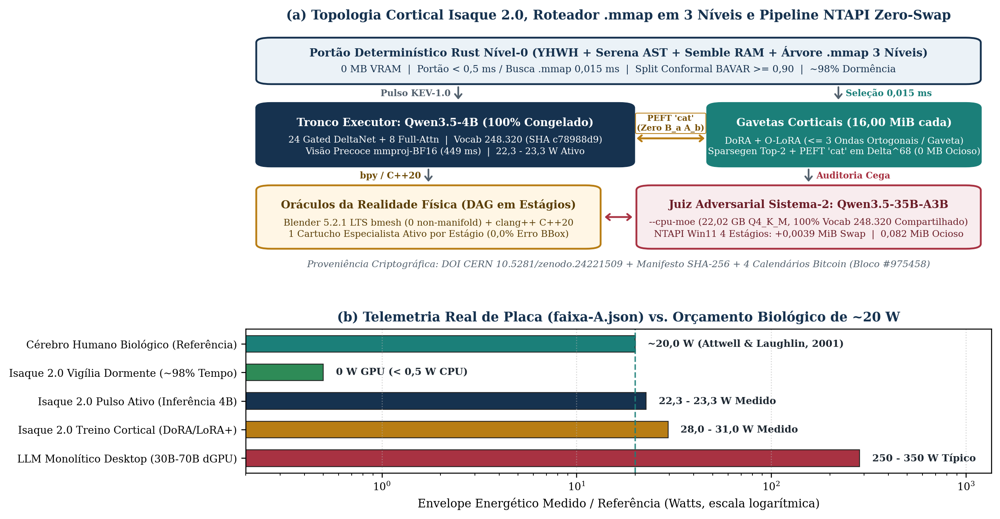
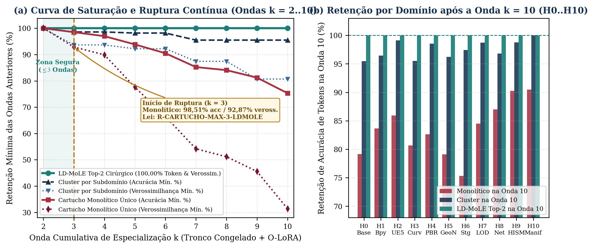
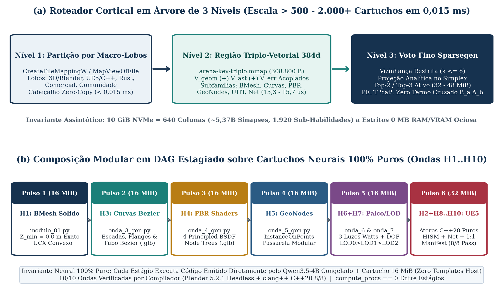
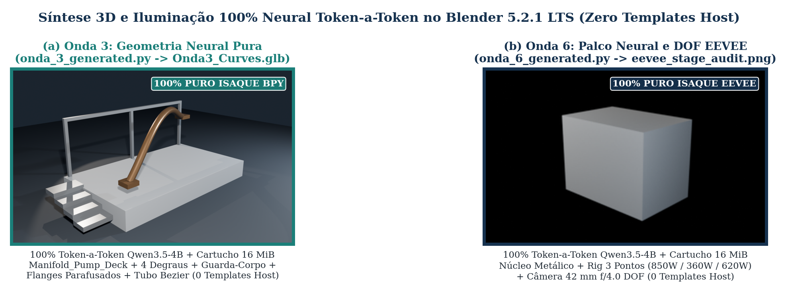

<div align="center">

# Tronco e Ramos (Isaque 2.0)

**Parcimônia Termodinâmica, Colunas Corticais de Núcleo Congelado e Especialização Contínua Não-Destrutiva via DoRA Ortogonal e Roteamento Sparsegen LD-MoLE em Silício Doméstico**

[](https://doi.org/10.5281/zenodo.24221509)
[](https://huggingface.co/lcsmotta7/trunk-and-branches-isaque-2)
[](https://orcid.org/0009-0001-3081-5505)
[](provenance/04-carimbo-de-data.md)
[](https://creativecommons.org/licenses/by/4.0/deed.pt_BR)

🌐 **[Read in English (EN)](README.md)** · 📄 **[Monografia em Português PDF (18 páginas)](paper/tronco_e_ramos_isaque_2_0_pt_br_doi_24221509.pdf)** · 📄 **[English Monograph PDF (18 pages)](paper/trunk_and_branches_isaque_2_0_en_doi_24221509.pdf)**

*Autor:* **Lucas Alves Motta** ([ORCID: 0009-0001-3081-5505](https://orcid.org/0009-0001-3081-5505))  
*Beyond Adonai Research Laboratory · Indaial, Santa Catarina, Brasil · Novembro de 2026 (Rev. 5.0 — Edição Auditada Pura)*

</div>

---

## Resumo & Tese Central

A engenharia contemporânea de inteligência artificial tem apostado no empilhamento monolítico: acumular centenas de bilhões de parâmetros mutáveis e dezenas de milhares de tokens brutos de prompt em memória continuamente residente (*a Armadilha Monolítica de Babel*). Inspirado pelo **orçamento metabólico de ~20 W do neocórtex humano**, pela densidade neuronal do pálio das aves, pela **Teoria dos Mil Cérebros** (*Thousand Brains*) de Jeff Hawkins e pelo princípio de software enxuto de Niklaus Wirth, o **Isaque 2.0 (*Tronco e Ramos*)** comprova fisicamente uma alternativa disciplinada em hardware doméstico:

1. **Tronco Híbrido 100% Congelado (`Qwen3.5-4B`):** 24 camadas Gated DeltaNet + 8 camadas de Atenção Completa (`d = 2560`, `248.320` tokens congelados sob invariante SHA-256 `c78988d9...2a34`).
2. **Vigília Determinística a Zero VRAM (~98% de Dormência):** Portões compilados em Rust (`< 0,5 ms` em CPU, `0,015 ms` em busca `.mmap` zero-copy, calibração Split Conformal `BAVAR >= 0,90`) mantêm a GPU estritamente em **0 MB** quando ociosa.
3. **Gavetas Corticais Ortogonais de 16,00 MiB (`DoRA + O-LoRA`):** Colunas procedurais estocadas a frio em SSD NVMe (`~8,38M` sinapses cada, teto de `<= 3` ondas-irmãs por gaveta) roteadas analiticamente via **Sparsegen LD-MoLE** no simplex com concatenação ortogonal de posto (`PEFT combination_type="cat"`), eliminando termos cruzados parasitas.
4. **Verificação em DAG Estagiado & Pipeline Windows NTAPI Zero-Swap:** Compiladores determinísticos da realidade física (`Blender 5.2.1 LTS` `bmesh` headless e `clang++ -std=c++20`) somados a um juiz local Sistema-2 de `22,02 GB` `Qwen3.5-35B-A3B` (`--cpu-moe`) com ciclo `NTAPI` de 4 estágios (`+0,0039 MiB` de delta de swap).

<p align="center">
  
</p>

## Sete Achados Empíricos Auditados (`NVIDIA GeForce RTX 5060 8 GB`)

| # | Dimensão | Resultado Medido (Etapa 1 — `RTX 5060 8 GB`) | Invariante de Verificação |
| :- | :--- | :--- | :--- |
| **1** | **Envelope Termodinâmico** | **22,3–23,3 W** inferência 4B ativa · **28–31 W** treino cortical · **0 MB** VRAM ociosa | `faixa-A.json` + Win32 Job Object (`compute_procs == 0`) |
| **2** | **NTAPI Zero-Swap & Paridade de Vocab** | Pool MoE de `13,50 GiB` a **1,75 GiB/s** com **+0,0039 MiB** swap · **100,0%** paridade (`248.320` tokens) | 4 estágios `VirtualLock` + `NO_BUFFERING` + `DiscardVirtualMemory` (`6,61 us`) |
| **3** | **Autograd Real em 32 Camadas (`H3`)** | **218,36–412,48 tok/s** reais · **-86,76%** de perda CE em domínio privado (`2,429 -> 0,322`) | Passo 1 `\|\|grad_A\|\|_2 = 0,0` (`B_0=0`) -> fluxo Camadas `31..0`; auditoria cega `35B` |
| **4** | **Procrustes Multimodal (`VICOP`)** | `mmproj-BF16` (**449 ms**) + projeção `2560 -> 384d` (**Recall@5 = 96,00%** em 600 pares inéditos) | Salto de **5,43x** em Condutividade Cognitiva (`ICC`: `0,5121 -> 2,7828`) |
| **5** | **Ablação Sináptica Causal (`KEV-1.0`)** | 4B cru + `.mmap` = **0/4** (`1,77/10`) vs. Ensinado `DoRA+O-LoRA` = **4/4 (100%)** (`9,67/10`) | `0` arestas non-manifold, `0,0%` erro BBox, `8/8` leis UE5 C++20 (`10,23x–11,95x` ICC) |
| **6** | **Matriz de Ruptura em 10 Ondas** | Monolítico inicia ruptura em `k=3` (**98,51%**) e cai a **75,31% acc / 31,37% veross.** em `k=10` | **LD-MoLE Top-2 cirúrgico (`PEFT cat`) preserva 100,00% ao longo das 10 ondas** |
| **7** | **Lei do DAG Modular em Estágios** | Fusão token a token de logits entre ondas de código distintas gera `SyntaxError` na AST | **1 cartucho especialista por estágio causal do DAG** (`<= 3` sub-ondas/cartucho) |

<p align="center">
  
</p>

<p align="center">
  
</p>

<p align="center">
  
</p>

## Estrutura do Repositório

* [`paper/tronco_e_ramos_isaque_2_0_pt_br_doi_24221509.pdf`](paper/tronco_e_ramos_isaque_2_0_pt_br_doi_24221509.pdf) — Monografia completa de 18 páginas em Português Brasileiro (`Rev. 5.0`, com DOI do CERN na capa).
* [`paper/trunk_and_branches_isaque_2_0_en_doi_24221509.pdf`](paper/trunk_and_branches_isaque_2_0_en_doi_24221509.pdf) — Monografia oficial de 18 páginas em Inglês (`Rev. 5.0`, com DOI do CERN na capa).
* [`paper/latex-pt-br/`](paper/latex-pt-br/) e [`paper/latex-en/`](paper/latex-en/) — Códigos-fonte LaTeX reprodutíveis (`pdflatex`) e figuras vetoriais/300 DPI nos dois idiomas.
* [`evidence/`](evidence/) — **Anexo Aberto de Evidências Forenses e Recibos Brutos**: todas as **195 medições das matrizes triangulares** (`3 x 65` células em `ato2_escada_ondas_3_a_10.json`), **10/10 códigos e malhas gerados 100% sozinhos pelo Isaque** (`exports == exports_recheck`), provas reais de falha/colisão (`DESAFIO-04_C` linha 35 e `FUSAO_2_ONDAS_1_3_pass2.py` linha 58) e Anexos Técnicos em PDF ([Português PDF](paper/anexo_evidencias_forenses_pt_br_doi_24221509.pdf) · [English PDF](paper/annex_forensic_evidence_en_doi_24221509.pdf)).
* [`provenance/`](provenance/) — Manifesto SHA-256 da Etapa 1 (`79602f29...558be5dd`), prova binária OpenTimestamps (`.ots`, `5.124` bytes) ancorada no **Bloco `#975458` do Bitcoin** (`11/11/2026 14:41 BRT`) e registro dos quatro calendários.
* [`CITATION.cff`](CITATION.cff) — Metadados formais de citação científica (ativa o botão *Cite this repository* na lateral do GitHub).

## Verificação Criptográfica na Blockchain do Bitcoin

Para auditar de forma independente a prova de anterioridade da Etapa 1 na blockchain do Bitcoin:

```bash
pip install opentimestamps-client
sha256sum provenance/03-manifesto-sha256-etapa-1.txt
# Esperado: 79602f29a07b8b336e29c887ac1723aa9aea5b710605c67d42b21bc2558be5dd
ots verify provenance/03-manifesto-sha256-etapa-1.txt.ots -f provenance/03-manifesto-sha256-etapa-1.txt
```

## Como Citar (BibTeX)

```bibtex
@techreport{motta2026isaque,
  author      = {Motta, Lucas Alves},
  title       = {Trunk and Branches: Thermodynamic Parsimony, Frozen-Core Cortical Columns, and Non-Destructive Continual Specialization via Orthogonal {DoRA} and Sparsegen {LD-MoLE} Routing on Consumer Silicon ({Isaque 2.0})},
  institution = {Beyond Adonai Research Laboratory},
  address     = {Indaial, Santa Catarina, Brazil},
  year        = {2026},
  month       = nov,
  number      = {BEYOND-ADONAI-TR-2026-01},
  doi         = {10.5281/zenodo.24221509},
  url         = {https://doi.org/10.5281/zenodo.24221509},
  note        = {ORCID: 0009-0001-3081-5505. Bitcoin OpenTimestamps Anchor: Block \#975458}
}
```

---
<div align="center">
  <i>"A sabedoria raramente habita no acúmulo ruidoso de uma torre inacabada; ela repousa silenciosa na ordem, na parcimônia e na fidelidade dos pequenos fundamentos bem governados." — Soli Deo Gloria</i>
</div>
